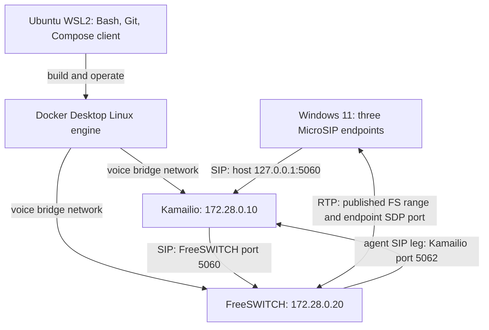

# Mini ACD Build + Learn pilot

Source boundary: runtime main 0ede99b515abdd805c472679d0d1cf8d0071e749, inspected 12 October 2026. This guide coordinates the existing runbook and Medha curriculum. Commands below are instructions and expected observations, not a claim that this session ran Docker or placed calls.

Start the [existing 24-chapter Medha journey](https://github.com/scubelabs/medha/blob/main/55-first-voice-lab/00-learning-path.md). Use its Windows/Docker or native Linux route. It preserves earlier user-reported registration, echo/queue audio and channel cleanup; independently collected packet evidence and native runtime proof remain separate. For the actual current build procedure use [the runbook](runbook-m1.md), [architecture](architecture.md), [call flows](call-flows.md) and [code walkthrough](LEARNING.md).

## Architecture you can explain



The diagram is a logical view. Docker Desktop forwarding, WSL networking, Windows adapters and firewall behavior must be observed on the workstation; it does not establish reachability. Kamailio is not on the RTP path for echo/queue. A queue call has a caller SIP dialog and a separate agent dialog. A direct endpoint call takes a different media path and does not prove queue/media anchoring.

## Lesson contract and curriculum map

For each row use What → Why → How → Architecture → Code → Hands-on Lab → Troubleshooting → Knowledge Check. Read the linked chapter, predict an outcome, execute only the authorized lab step, record actual evidence, then explain the result without copying the answer. Chapter numbers refer to the existing ordered path above.

| Topic / lessons | What, why and how | Architecture / actual source | Validation and knowledge check |
|---|---|---|---|
| Windows/WSL, 2–3 | Windows hosts the endpoint UI; Ubuntu WSL2 supplies Linux tools and Bash. Linux matches the server runtime, package tooling and shell scripts. Native Windows development is possible for browser/UI work, but does not directly run these Linux service binaries/scripts. Docker Desktop supplies the Linux engine; the WSL terminal is a client, not proof the engine lives inside that Ubuntu distribution | Windows endpoint and Linux service environments; Dockerfiles use Debian/bookworm | Record Windows/WSL/Docker versions. Explain why using Ubuntu commands in PowerShell fails and why WSL is not itself a Docker container |
| Images/containers, 4–8 | Dockerfile is a build recipe; image is a filesystem/configuration template; container is an isolated running process plus writable layer. Compose declares the two services and their relationship | kamailio/Dockerfile pins 5.8.5-bookworm; freeswitch/Dockerfile installs authenticated Debian packages with BuildKit secret | Build and inspect service health; explain why EXPOSE does not publish a host port |
| Storage/lifecycle, 4/14 | Named volumes persist outside container recreation; bind mounts map host files; the container writable layer survives stop/start but is discarded on removal/recreation. This Compose file declares neither service volumes nor named volumes | FreeSWITCH SQLite state is inside /var/lib/freeswitch/db; config is copied into images. The fs_auth build secret is not a persistent data volume | Predict stop/start vs down/recreate state. Check actual agent state after restart. Do not claim durable queue state across recreation |
| Networks/ports, 9 | Docker bridge supplies a private subnet; publishing maps host sockets to container sockets. Loopback has meaning relative to the process's network world | voice 172.28.0.0/24; K .10, FS .20; host SIP 5060 UDP/TCP; host FS RTP 16384–16484 UDP; private agent proxy 5062 | Inspect Compose and both SDP destinations. Explain why changing LAB_PUBLIC_IP cannot fix an unreachable endpoint or change port bindings |
| Kamailio, 11/16 | SIP proxy forwards instructions; registrar saves contact/received destinations. REGISTER associates an identity with a reachable signaling destination | kamailio.cfg: save("location"), lookup("location"), t_relay(), record_route(), loose_route(); db_mode=0, username-only lab realm | ul.dump must show 1001/1002/2000. Explain why FreeSWITCH registration output is not the right place to find them |
| FreeSWITCH, 12/16 | Media server/B2BUA creates separate dialogs, answers/treats caller, chooses available queue agent and bridges media | freeswitch.xml: mod_sofia, mod_dialplan_xml, mod_callcenter; echo 9196; queue 7000/support@default; longest-idle-agent; agent contacts target .10:5062 | Check modules/codecs/queue/agents, audible echo, each agent, both hangup directions. Explain why caller answer is earlier than agent answer |
| MicroSIP, 10–13 | Three separate endpoint instances represent caller 2000 and agents 1001/1002. Separate local signaling ports avoid collisions | Runbook server/proxy 127.0.0.1:5060, UDP; suggested endpoint SIP ports 5071/5072/5073; PCMU/PCMA | Verify observed Contact/received address and endpoint SDP, microphone/speaker and RTP direction. These local SIP ports are not endpoint audio ports |
| REGISTER/authentication, 11/16/22 | Production Digest challenges prove credential knowledge. This source does not challenge/validate passwords; its identity allowlist is not authentication. Generic 401/407 examples are future learning, not captured M1 behavior | REGISTER allows only 1001/1002/2000; FreeSWITCH auth-calls=false | Record actual messages. Reject an unknown lab identity; never label a permitted user/password entry authenticated. Explain authentication vs authorization |
| INVITE/SDP/RTP/BYE, 11–16 | INVITE requests a dialog; SDP describes proposed media addresses/codecs; RTP carries audio; BYE ends an established dialog. ACK confirms successful INVITE handling; CANCEL concerns a pending INVITE | Echo and queue XML; Kamailio transaction/dialog routes; actual RTP ports selected from SDP within configured range | Capture INVITE/response/ACK, each SDP body, both RTP directions and BYE/200. Packet arrival, answer and audibility are separate observations |
| Native deployment, 17–21/24 | Packages run directly as dedicated service accounts, managed by systemd. You own address configuration, firewall, permissions, backups and upgrades instead of container lifecycle | Existing Medha hash-checked native config generator, one/two-server route and restore instructions | Use measured isolated LAN addresses as generator inputs; review output before privileged installation. Prove same call ladder, reboot and restore. Native runtime was not executed here |
| Production engineering, 22–23 | Security, capacity and failure behavior need explicit evidence rather than a carrier-grade repository name | Unauthenticated LAN/local lab, in-memory Kamailio location, single media server and development event-socket credential | Define credential/ACL/TLS/SRTP policy, secret rotation, state recovery, admission/overload, metrics, failure domains and rollback. Load/HA/multi-carrier are not implemented certifications |

## Read real configuration before running it

From docker-compose.yml:

```yaml
ports:
  - "127.0.0.1:5060:5060/udp"
```

Left IP restricts the host listener to loopback; the first 5060 is the host port; the second is the container port; udp selects transport. The TCP mapping is a separate declaration. The FreeSWITCH RTP declaration publishes a range, not a fixed negotiated call port. The Compose dependency waits for FS health, not for a successful phone call.

From freeswitch/conf/freeswitch.xml:

```xml
<condition field="destination_number" expression="^7000$">
  <action application="answer"/>
  <action application="set" data="hangup_after_bridge=true"/>
  <action application="callcenter" data="support@default"/>
</condition>
```

The condition selects queue number 7000. answer answers the caller leg immediately. set supplies the bridge hangup policy. callcenter places that leg in the named queue; it does not prove an agent was reached. Agent contacts target Kamailio's private socket; registered endpoint location and ACD availability are separate authorities. See LEARNING.md for the statement-by-statement REGISTER explanation.

## Practical command gates

Run in the repository's WSL Bash terminal after reading package-secret setup in runbook-m1.md. Expected observations below are acceptance targets; output formatting and dynamic contacts/ports vary.

```bash
git status --short
git rev-parse HEAD
python3 scripts/validate-config.py
python3 -m unittest discover -s tests -v
docker compose config --quiet
./scripts/preflight.sh
docker compose build --no-cache
docker compose up -d --wait
docker compose ps
docker compose exec -T freeswitch fs_cli -x 'sofia status'
docker compose exec -T freeswitch fs_cli -x 'callcenter_config queue list'
docker compose exec -T kamailio kamcmd ul.dump
docker compose exec -T freeswitch fs_cli -x 'show channels'
```

Expected: static checks exit zero; FS internal profile RUNNING at 172.28.0.20:5060; support@default exists; after registration location includes 1001,1002,2000; after completed hangups no active channels remain. These observations do not establish audibility, authentication, complete capture analysis or personal mastery. Package access is needed for the FS build. Never put a real token in a command argument or repository.

Dial 9196 from 2000, speak, inspect return audio and hang up. Then dial 7000 with the runbook's controlled agent availability steps; prove 1001 and 1002 separately, then caller-side and agent-side teardown. Collect sanitized diagnostics with ./scripts/diagnostics.sh. Retain the previous successful workstation evidence before changing configuration.

## Troubleshooting exercise: predict, break, observe, restore

1. In the disposable local lab, make one registered agent Logged Out. Predict whether ul.dump changes. Call 7000, observe selection, then restore Available. Expected lesson: registration and queue availability are independent.
2. Without changing configuration, inspect a silent-call SDP. Identify whether an endpoint advertised 127.0.0.1. Explain what that means to FreeSWITCH inside its container. Compare with the recorded Medha SDP fix; do not assume every workstation uses the recorded address.
3. Explain a connected call dropping near 30 seconds using the ACK and route path. Inspect packets/logs before changing timers. A symptom is a hypothesis, not a diagnosed root cause.
4. Compare restarting a process/container with recreating the container. Record what survives and explain the difference; export reviewed evidence first and do not remove future volumes casually.

## Independent pilot evidence record

For each attempt record tested SHA, Windows/WSL/Docker versions, topology, image/package versions, sanitized command results, expected vs observed SIP/media, failure hypothesis, repair and restore. Record learning evidence separately from source completion.

| Gate | Current evidence boundary | Promotion criterion |
|---|---|---|
| Engineering source | M1 source and baseline CI exist | Reviewed acceptance evidence pinned to tested source |
| Walkthrough | This guide, LEARNING.md and existing Medha path | Reviewer confirms consistency with tested SHA |
| Exercise attempted | Earlier user-reported lab observations; no new attempt in this session | Learner supplies attempt record, including unsuccessful attempts |
| Understanding validated | Unverified | Learner explains both dialogs/media paths and diagnoses a controlled failure using evidence |

Next exercise: draw both queue dialogs, annotate advertised vs bound addresses, show which component owns registration vs availability, and explain why a green build cannot prove audible audio. Then defend a production migration plan including authentication, durable state, overload and media failure. Knowledge-check answers and AI-generated diagrams do not award mastery.
